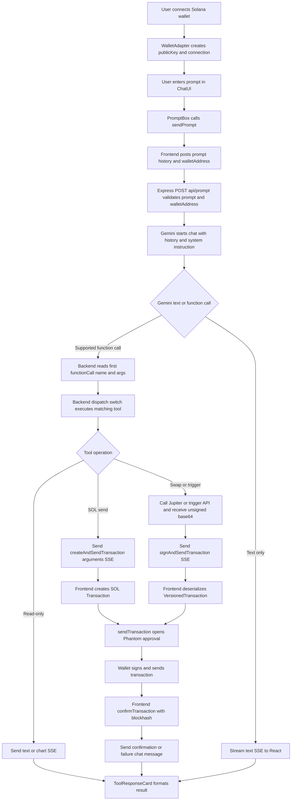

# DefAI — Interview Guide

This guide is based only on the source code present in this repository. Statements not verifiable in the code are marked **"Not confirmed from the codebase."** Environment values and secrets are not reproduced.

## 1. Project Overview

### What DefAI is

DefAI is a React and Express application that lets a user operate a Solana wallet through a Gemini-powered natural-language chat interface. The frontend is [client/src/App.tsx](client/src/App.tsx), and the backend is [server/index.js](server/index.js).

The application combines three areas:

1. Chat-based interpretation through Google Gemini.
2. Solana and third-party market operations.
3. Wallet approval and transaction signing in the browser through Phantom or another supported Solana wallet adapter.

### DeFi problem it solves

The implemented interface reduces the need for users to manually navigate separate balance, portfolio, swap, token-price, transaction-history, contact, and trigger-order screens. A request such as “Check my SOL balance” is converted into a tool call, and balance or transaction information is returned in the chat.

For action requests, the backend prepares data or an unsigned/base64 transaction, then the browser wallet asks the user to approve it. This lets the application reduce operational friction without storing a private key in the frontend chat state.

### Why natural-language interaction is useful

Natural language gives the user one entry point for several operations. The backend exposes explicit Gemini function declarations, so the model can turn a sentence into structured arguments instead of the frontend trying to understand every sentence itself.

The architecture is still tool-oriented: Gemini decides whether a supported tool fits the request, while the backend executes the corresponding JavaScript function. This is more auditable than asking the model to construct arbitrary blockchain transactions directly.

### Main implemented features

**Confirmed in the code**

- Solana wallet connection using the wallet adapter and wallet modal.
- Native SOL balance lookup.
- Portfolio lookup using Helius balances plus DexScreener token metadata.
- Token price lookup using DexScreener.
- SOL transaction construction in the frontend.
- Contact name resolution stored in a JSON file.
- Sending SOL to an address or a saved contact name.
- Jupiter quote and swap transaction preparation.
- Jupiter trigger-order creation, listing, cancellation, and execute helper.
- Recent Solana transaction signature history.
- Historical CoinGecko prices displayed as Recharts charts.
- Token performance comparison displayed as a Recharts chart.
- Streaming server-sent events from Express to the React client.
- Tool-response cards for balances, charts, contacts, portfolios, history, and errors.

**Implemented but not active in the main route**

- [server/tools/buyToken.js](server/tools/buyToken.js) contains a Jupiter buy flow, but it is not imported or declared in [server/routes/aiRoutes.js](server/routes/aiRoutes.js).
- [server/mcp/mcpServer.js](server/mcp/mcpServer.js) and [server/mcp/solanaServer.js](server/mcp/solanaServer.js) are standalone MCP experiments. They are not started by [server/index.js](server/index.js) and are not connected to the active Gemini route.
- [server/utils/solana.js](server/utils/solana.js) defines a backend Keypair-style utility, but it is not imported by the active route and has an incomplete import for `clusterApiUrl`.
- [client/src/wallets/evm.ts](client/src/wallets/evm.ts) and [client/src/components/WalletConnector.tsx](client/src/components/WalletConnector.tsx) provide MetaMask/EVM utilities, but they are not imported by [client/src/App.tsx](client/src/App.tsx). The main application is Solana-only.

**Not confirmed from the codebase**

- Production deployment status.
- Accuracy or success-rate metrics.
- Persisted chat history.
- Database-backed user accounts.
- Automated transaction notifications or background execution.
- Audited smart contracts or a formally audited system.

### Intended users

The code supports Solana wallet users who want to:

- Check balances and recent activity.
- View portfolio holdings.
- Compare token price histories.
- Send SOL.
- Prepare Jupiter swaps.
- Create or cancel Jupiter trigger orders.
- Store simple contact names for repeated transfers.

It is mainly a crypto or DeFi demo/chat agent; the repository does not confirm an enterprise or production multi-user product.

---

## 2. Technology Stack

| Technology | Where it is used | What it does and why it appears to be chosen |
|---|---|---|
| React 19 + TypeScript | [client/src](client/src) | Builds the chat UI and wallet experience. TypeScript types the chat, chart, and tool payloads. |
| Vite 7 | [client/vite.config.ts](client/vite.config.ts), [client/package.json](client/package.json) | Development server and frontend build tool. |
| Tailwind CSS 4 | [client/src/index.css](client/src/index.css), [client/vite.config.ts](client/vite.config.ts) | Supplies the dark UI theme and utility-based styling. |
| Radix UI and shadcn-style components | [client/src/components/ui](client/src/components/ui) | Provides accessible popovers, dialogs, tooltips, and UI primitives. |
| Lucide React | Chat and tool shortcut components | Supplies interface icons. |
| Recharts | [client/src/components/ui/chart.tsx](client/src/components/ui/chart.tsx) | Renders price history and token comparison line charts. |
| React Markdown + highlight.js | [client/src/components/ChatUI.tsx](client/src/components/ChatUI.tsx) | Renders model output as Markdown and provides code highlighting. |
| Express 5 | [server/index.js](server/index.js), [server/routes/aiRoutes.js](server/routes/aiRoutes.js) | Hosts the `/api/prompt` SSE endpoint and JSON middleware. |
| Google Gemini SDK | [server/routes/aiRoutes.js](server/routes/aiRoutes.js) | Calls the `gemini-2.0-flash` model and receives function calls. |
| `@google/generative-ai` | Server route | Active Gemini SDK used by the model. Other Gemini/OpenAI/AI SDK dependencies exist in `package.json` but are not confirmed as active in the route. |
| Zod | MCP server files | Defines MCP tool input schemas in the standalone MCP experiment. The active Gemini route uses raw Gemini function declarations instead. |
| Solana Web3.js | [server/tools](server/tools), [client/src/hooks/useChatLogic.ts](client/src/hooks/useChatLogic.ts), [client/src/providers/SolanaProvider.tsx](client/src/providers/SolanaProvider.tsx) | Creates `PublicKey`, `Connection`, SOL transfer transactions, and versioned transactions. |
| Solana wallet adapter | [client/src/providers/SolanaProvider.tsx](client/src/providers/SolanaProvider.tsx) | Integrates Phantom, Solflare, and Torus and exposes `useWallet` and `useConnection`. |
| Helius RPC/API | Wallet provider and portfolio tool | Frontend RPC endpoint is Helius; the portfolio endpoint is Helius's wallet balances API. |
| Jupiter Lite API | [server/tools/swapTokens.js](server/tools/swapTokens.js), [server/tools/triggerOrder.js](server/tools/triggerOrder.js) | Returns swap/trigger quotes and unsigned base64 Solana transactions. |
| Jupiter old v6 helpers | [server/tools/buyToken.js](server/tools/buyToken.js) | Placeholder-style buy flow; not registered in the active route. |
| DexScreener | Swap/trigger token resolution, portfolio metadata, current price | Resolves token names or mint addresses and retrieves current pair prices. |
| CoinGecko | [server/tools/getPriceHistory.js](server/tools/getPriceHistory.js), [server/tools/getTokenComparison.js](server/tools/getTokenComparison.js) | Retrieves historical USD prices for charts. |
| Server-sent events | [server/routes/aiRoutes.js](server/routes/aiRoutes.js), [client/src/hooks/useChatLogic.ts](client/src/hooks/useChatLogic.ts) | Streams text, chart, tool-code, and error events using `text/event-stream`. |
| Contact JSON storage | [server/tools/contacts.js](server/tools/contacts.js), [server/data/contacts.json](server/data/contacts.json) | Stores name-to-wallet-address mappings in a local JSON file. |
| MCP SDK | [server/mcp/mcpServer.js](server/mcp/mcpServer.js), [server/mcp/solanaServer.js](server/mcp/solanaServer.js) | Standalone Model Context Protocol experiments only. |
| dotenv | Server entry and tools | Loads server environment variables. |
| CORS | [server/index.js](server/index.js) | Allows cross-origin browser requests. It uses unrestricted `cors()` in the active entry point. |
| Node Fetch / cross-fetch | Server API integrations | Performs HTTP calls to Jupiter, DexScreener, Helius, and CoinGecko. |
| MongoDB/Mongoose | Dependency and commented code only | MongoDB is not connected or used by active code. |
| Authentication library or framework | Not implemented | There is no login, JWT, session, OAuth, or wallet-signature authentication service. |

### Frontend and backend selection rationale

The frontend selection is visible in code, but there is no written requirements document. It is reasonable to describe React/Vite as a fast browser SPA, Radix/Tailwind as UI tooling, and Recharts as chart support. The exact original selection rationale is **Not confirmed from the codebase.**

---

## 3. Complete Folder and File Structure

```text
Defai/
├── package.json
├── package-lock.json
├── DEFAI_INTERVIEW_GUIDE.md
├── client/
│   ├── package.json
│   ├── vite.config.ts
│   ├── index.html
│   ├── .env
│   ├── README.md
│   ├── tsconfig.json
│   ├── tsconfig.app.json
│   ├── tsconfig.node.json
│   ├── tailwind.config.ts
│   ├── eslint.config.js
│   ├── components.json
│   └── src/
│       ├── App.tsx
│       ├── main.tsx
│       ├── index.css
│       ├── vite-env.d.ts
│       ├── components/
│       │   ├── ChatUI.tsx
│       │   ├── ToolResponeCard.tsx
│       │   ├── ToolShortcut.tsx
│       │   ├── WalletConnector.tsx
│       │   └── ui/
│       │       ├── avatar.tsx
│       │       ├── button.tsx
│       │       ├── chart.tsx
│       │       ├── chatgpt-prompt-input.tsx
│       │       ├── input.tsx
│       │       ├── label.tsx
│       │       ├── popover.tsx
│       │       ├── separator.tsx
│       │       └── textarea.tsx
│       ├── hooks/
│       │   └── useChatLogic.ts
│       ├── lib/
│       │   └── utils.ts
│       ├── providers/
│       │   └── SolanaProvider.tsx
│       ├── types/
│       │   └── index.ts
│       └── wallets/
│           ├── evm.ts
│           └── solana.ts
└── server/
    ├── index.js
    ├── package.json
    ├── data/
    │   └── contacts.json
    ├── routes/
    │   └── aiRoutes.js
    ├── mcp/
    │   ├── mcpServer.js
    │   └── solanaServer.js
    ├── tools/
    │   ├── buyToken.js
    │   ├── contacts.js
    │   ├── getBalance.js
    │   ├── getPortfolio.js
    │   ├── getPriceHistory.js
    │   ├── getTokenComparison.js
    │   ├── getTokenPrice.js
    │   ├── getTransactionHistory.js
    │   ├── send.js
    │   ├── swapTokens.js
    │   └── triggerOrder.js
    └── utils/
        └── solana.js
```

### Frontend entry and provider files

#### `client/src/main.tsx`

- **Purpose:** Browser entry point.
- **Important code:** `createRoot`, `StrictMode`, `SolanaProvider`, `App`.
- **Flow:** Mounts `App` inside `SolanaProvider`.
- **Calls:** `SolanaProvider`, `App`.
- **Called by:** Browser loading [client/index.html](client/index.html).
- **Output:** React application in the `root` DOM element.

#### `client/src/App.tsx`

- **Purpose:** Top-level layout.
- **Important code:** `WalletMultiButton`, `ChatUI`.
- **Flow:** Renders the wallet button in the upper-right and chat interface.
- **Calls:** `WalletMultiButton` and `ChatUI`.
- **Calls neither:** It does not directly call wallet or chat hook logic.

#### `client/src/providers/SolanaProvider.tsx`

- **Purpose:** Configures Solana RPC and wallet providers.
- **Important code:** `SolanaProvider`, `ConnectionProvider`, `WalletProvider`, `WalletModalProvider`, `wallets`.
- **Wallet adapters:** Phantom, Solflare, Torus.
- **Network:** Hard-coded as mainnet through the Helius mainnet endpoint. The environment variable only supplies the Helius API key; the Vite network variable is not read here.
- **Behavior:** `autoConnect` attempts trusted wallet reconnection.
- **Input:** React children.
- **Output:** Context consumed by `useConnection` and `useWallet`.

#### `client/src/hooks/useChatLogic.ts`

This is the main frontend orchestration file.

- **State:** `messages`, `loading`, `inputValue`.
- **Wallet hooks:** `useConnection`, `useWallet`.
- **`addMessage(role, content, isToolResponse)`**
  - Adds a message to local React state.
  - Input: role, text/chart content, tool flag.
  - Output: updated `messages`.
  - Called by UI stream handling and transaction functions.
- **`handleCreateAndSend(toolResult)`**
  - Handles SOL-only `createAndSendTransaction`.
  - Checks wallet connection, converts SOL to lamports, checks balance plus 5,000 lamports, validates the recipient public key, requests a recent finalized blockhash, creates and signs/sends a standard `Transaction`.
  - Calls `getBalance`, `getLatestBlockhash`, `sendTransaction`, and `confirmTransaction`.
  - Input: `toAddress`, `amount`, `tokenSymbol`.
  - Output: chat status messages and a Solscan link.
- **`handleSignAndSend(toolResult)`**
  - Handles swaps or trigger transactions returned as base64 versioned transactions.
  - Deserializes using `VersionedTransaction.deserialize`.
  - Calls `sendTransaction`, obtains a blockhash, and calls `confirmTransaction`.
  - Input: base64 transaction and optional `orderId`.
  - Output: sent/confirmed/cancelled/failed chat messages.
- **`sendPrompt(value)`**
  - Rejects blank prompts and requires a connected wallet/public key.
  - Appends the user message and sends `prompt`, `history`, and `walletAddress` to the backend.
  - Reads SSE chunks, appending text or charts and routing tool code to transaction handlers.
  - Input: user prompt.
  - Output: streamed state updates.
- **Return:** `messages`, `loading`, `inputValue`, `setInputValue`, `sendPrompt`, `connected`.

#### `client/src/components/ChatUI.tsx`

- **Purpose:** Chat layout and message rendering.
- **Uses:** `useChatLogic`, `ToolShortcut`, `PromptBox`, `ToolResponseCard`.
- **Behavior:** Auto-scrolls; distinguishes tool responses; supports Markdown and copy-to-clipboard; shows loading dots.
- **Prompt gating:** Wallet must be connected and the app must not be loading.
- **Important components:** `ChatUI`, message map, loading UI.
- **Connections:** Calls `sendPrompt` and displays messages produced by `useChatLogic`.

#### `client/src/components/ToolResponeCard.tsx`

- **Purpose:** Formats tool-response text as cards.
- **Important code:** `ToolIcon`, `parseContent`, `ToolResponseCard`.
- **Input:** `string | ChartData`.
- **Behavior:** Uses string prefix/regex patterns to select card titles and status. Charts are rendered through [client/src/components/ui/chart.tsx](client/src/components/ui/chart.tsx).
- **Output:** Styled status card with “View Full Result”.

#### `client/src/components/ToolShortcut.tsx`

- **Purpose:** Provides example prompts for swap, send, balance, trigger, portfolio, and history.
- **Important code:** `tools`, `ToolShortcut`, `handleExampleClick`.
- **Input:** `setInputValue`.
- **Output:** Popover prompts written into the chat textbox.

#### `client/src/components/WalletConnector.tsx`

- **Purpose:** Alternative standalone wallet UI for MetaMask and Phantom.
- **Status:** Not mounted in `App.tsx`, so it is not part of the active main application.
- **Important code:** `handleMetaMaskConnect`, `handlePhantomConnect`, auto-reconnect effects.
- **Connections:** Calls helpers in `wallets/solana.ts` and `wallets/evm.ts`.

#### `client/src/types/index.ts`

Defines frontend data contracts:

- `SendTxArgs`: `toAddress`, `amount`, `tokenSymbol`.
- `CreateAndSendContent`: SOL transaction instructions.
- `SignAndSendContent`: base64 versioned transaction and optional order ID.
- `ChartData`: title, type, labels, values or series.
- `Message`: role, content, tool flag.
- `StreamData`: text, chart, error, or tool-code SSE payload.

#### `client/src/wallets/solana.ts`

- **Purpose:** Direct browser Phantom helper.
- **`connectPhantom()`**
  - Checks `window.solana?.isPhantom`.
  - Calls `provider.connect()`.
  - Returns the public key string or `null`.
- **Used by:** Standalone `WalletConnector`, not active `SolanaProvider`.

#### `client/src/wallets/evm.ts`

- **Purpose:** MetaMask connector experiment.
- **Status:** Not mounted and no backend EVM route exists.

#### `client/src/components/ui/chatgpt-prompt-input.tsx`

- **Purpose:** Large chat textarea and actions.
- **Important code:** `PromptBox`, `handleSubmit`, image preview, tool popover, voice placeholder.
- **Input:** `onSubmitPrompt`, `loading`, `value`, `setValue`.
- **Output:** Calls `onSubmitPrompt(value)` on Enter or send click.
- **Actual tool-related UI:** Selecting a tool only changes a visual label. It does not add a backend tool restriction.
- **Image attachment:** Stores a local preview only; it is not sent to the backend.
- **Microphone:** UI button only; no voice recording implementation is confirmed.

#### Remaining frontend UI files

- [client/src/components/ui/avatar.tsx](client/src/components/ui/avatar.tsx): Avatar primitives.
- [client/src/components/ui/button.tsx](client/src/components/ui/button.tsx): Class Variance Authority button variants.
- [client/src/components/ui/input.tsx](client/src/components/ui/input.tsx): Styled input primitive.
- [client/src/components/ui/label.tsx](client/src/components/ui/label.tsx): Radix label primitive.
- [client/src/components/ui/popover.tsx](client/src/components/ui/popover.tsx): Popover primitives.
- [client/src/components/ui/separator.tsx](client/src/components/ui/separator.tsx): Separator primitive.
- [client/src/components/ui/textarea.tsx](client/src/components/ui/textarea.tsx): Textarea primitive.
- [client/src/lib/utils.ts](client/src/lib/utils.ts): `cn()` combines `clsx` and Tailwind merge.
- [client/src/index.css](client/src/index.css): Theme variables and Tailwind imports.
- [client/src/App.tsx](client/src/App.tsx), [client/src/main.tsx](client/src/main.tsx): Application mount.

### Backend entry and routes

#### `server/index.js`

- **Purpose:** Starts the Express server.
- **Important code:** `express()`, `dotenv.config()`, CORS middleware, JSON middleware, route mount, `listen`.
- **Route mount:** `/api` with [server/routes/aiRoutes.js](server/routes/aiRoutes.js).
- **Default port:** `8080`.
- **No active MongoDB connection:** The MongoDB code is commented out.
- **No static frontend serving:** The frontend is launched separately with Vite.

#### `server/routes/aiRoutes.js`

This is the active backend orchestrator.

- **Imports:** Gemini SDK, contact functions, and all active tool modules.
- **Tool declarations:** `tools` array contains Gemini function declarations.
- **Model:** `gemini-2.0-flash`.
- **System instruction:** “You are a DeFi AI assistant specializing in Solana and crypto.”
- **Safety settings:** All configured dangerous-content categories use `BLOCK_NONE` in this file.
- **Chat:** `model.startChat({ history })`.
- **Streaming:** `chat.sendMessageStream(prompt)`.
- **Tool dispatch:** Streams text immediately, reads `functionCalls()`, and executes only `functionCalls[0]`.
- **Result:** Writes SSE events and ends the response.
- **Validation:** Only basic checks such as prompt and wallet presence exist at the route level.

### Backend tool files

#### `server/tools/getBalance.js`

- **Purpose:** Get native SOL balance.
- **Input:** `{ tokenSymbol, publicKey }`.
- **Output:** `{ balance: "<number> SOL" }`.
- **Calls:** `Connection`, `PublicKey`, `getBalance`.
- **Validation:** Only `SOL` is supported and public key is required.
- **Caller:** `getBalance` case in the Gemini route.

#### `server/tools/send.js`

- **Purpose:** Prepare data for a SOL transfer. It does not submit the transaction.
- **Input:** `{ fromAddress, toAddress, amount, tokenSymbol }`.
- **Validation:** Required fields and token must be SOL.
- **Output:** `{ toAddress, amount, tokenSymbol }`.
- **Caller:** `send` route case.
- **Callee:** The frontend `handleCreateAndSend`, then Solana RPC.

#### `server/tools/swapTokens.js`

- **Purpose:** Resolve tokens and prepare a Jupiter swap transaction.
- **Functions:** `getTokenMintByName`, `getTokenInfo`, default export `swapTokens`.
- **Input:** `{ fromToken, toToken, amount, walletAddress }`.
- **Known tokens:** SOL, USDC, USDT, JUP.
- **Unknown tokens:** DexScreener search endpoint; resulting decimals default to 6.
- **Quote:** Jupiter Lite `quote` endpoint with `slippageBps=50`.
- **Transaction:** Jupiter Lite `swap` endpoint.
- **Output:** `{ serializedTx, quote, from, to, amountUnits }`.
- **Caller:** `swapTokens` route case.
- **Callee:** Frontend `handleSignAndSend`.

#### `server/tools/getPortfolio.js`

- **Purpose:** Build a text portfolio snapshot.
- **Input:** `{ walletAddress }`.
- **Native balance:** Helius balance response's `nativeBalance`, converted from lamports.
- **SPL balances:** Reads `tokens`, applies each token's decimals, and resolves metadata via DexScreener.
- **Output:** Markdown-like text or an inability/error message.
- **Caller:** `getPortfolio` route case.

#### `server/tools/getTokenPrice.js`

- **Purpose:** Resolve a token name/symbol and get its most-liquid DexScreener USD pair.
- **Input:** `{ tokenSymbol }`.
- **Output:** Markdown text such as the current price.
- **Caller:** `getTokenPrice` route case.

#### `server/tools/getTransactionHistory.js`

- **Purpose:** Return recent signatures for a wallet.
- **Input:** `{ walletAddress, limit }`.
- **Default limit:** 5.
- **Calls:** `getSignaturesForAddress`.
- **Output:** Markdown list with Solscan links.
- **Caller:** `getTransactionHistory` route case.

#### `server/tools/getPriceHistory.js`

- **Purpose:** Retrieve historical prices and return chart-friendly arrays.
- **Input:** `{ tokenSymbol, days }`.
- **Default:** 7 days.
- **CoinGecko mapping:** SOL and a fixed set of other symbols.
- **Retry:** Up to three attempts with increasing delay.
- **Output:** `{ tokenSymbol, days, timestamps, prices }`.
- **Caller:** `getPriceHistory` route case.

#### `server/tools/getTokenComparison.js`

- **Purpose:** Compare normalized percentage changes for two CoinGecko tokens.
- **Input:** `{ token1, token2, days }`.
- **Normalization:** `(price - firstPrice) / firstPrice * 100`.
- **Output:** chart object containing labels and two series.
- **Caller:** `getTokenComparison` route case.

#### `server/tools/triggerOrder.js`

- **Purpose:** Prepare, execute, cancel, and list Jupiter trigger orders.
- **Known tokens:** SOL, USDC, USDT, BONK, JUP.
- **`getMintAddress(symbolOrMint)`**
  - Returns 44-character mint-like strings as-is.
  - Otherwise looks up known metadata or DexScreener.
- **`createTriggerOrder(params)`**
  - Converts maker/taker amounts to token units.
  - Calls Jupiter Lite `createOrder`.
  - Output: Jupiter's `{ transaction, orderId, ... }`.
- **`executeTriggerOrder(params)`**
  - Posts a signed transaction base64 string to Jupiter Lite.
- **`cancelTriggerOrder(params)`**
  - Calls Jupiter Lite `cancelOrder`.
  - Retries network/rate-limit/server failures up to three attempts.
- **`getTriggerOrders(params)`**
  - Gets active orders for the wallet.
- **Caller:** Gemini route create, execute, cancel, and list cases.

#### `server/tools/contacts.js`

- **Functions:** `getContacts`, `saveContacts`, `addContact`, `getContact`, `removeContact`.
- **Storage:** Relative path `./data/contacts.json`.
- **Behavior:** Names are lowercased.
- **Input/output:** Plain text/address strings.
- **Used for:** Resolving names before transfer and contact management commands.

#### `server/tools/buyToken.js`

- **Purpose:** Proposed Jupiter v6 buy helper.
- **Status:** Not included in the active Gemini tool declarations or route imports.
- **Behavior:** Resolves a token via DexScreener, uses SOL as input, requests a quote, and returns a base64 transaction.
- **No active caller.**

#### `server/utils/solana.js`

- **Purpose:** Intended shared Solana keypair/connection utility.
- **Status:** Dormant.
- **Reads:** `SOLANA_SECRET_KEY` and `SOLANA_NETWORK`.
- **Problem:** The file imports `Connection` and `Keypair` but uses `clusterApiUrl` without importing it.
- **Active route:** It is not imported, and no backend private key is used for the normal send/swap flows.

#### `server/mcp/mcpServer.js`

- **Purpose:** Standalone MCP server example using stdio.
- **Tools:** `getBalance`, placeholder `send`, placeholder `swap`.
- **Status:** Not invoked by the Express server or Gemini route.
- **Security note:** Send/swap are placeholders; swap is not implemented.

#### `server/mcp/solanaServer.js`

- **Purpose:** Standalone AI SDK MCP server with a `getBalance` tool.
- **Status:** Dormant and not registered in Express.

---

## 4. Complete End-to-End Workflow

### Real chat workflow



### Example: “Check my SOL balance”

1. **User enters prompt:** `ChatUI` receives the value through `PromptBox`.
2. **Frontend sends:** `sendPrompt` adds a user message and POSTs to `http://localhost:8080/api/prompt`.
3. **Body:** `{ prompt, history, walletAddress }`.
4. **Backend receives:** `router.post('/prompt')` validates prompt and wallet address.
5. **LLM interprets:** Gemini sees `getBalance` declaration and is likely to emit a function call with `tokenSymbol: "SOL"`.
6. **Tool dispatch:** `case 'getBalance'` calls `getBalance({ ...args, publicKey: walletAddress })`.
7. **Tool operation:** `getBalance` creates a network connection and calls `connection.getBalance(new PublicKey(publicKey))`.
8. **Conversion:** Lamports are divided by `LAMPORTS_PER_SOL` and formatted with nine decimals.
9. **Response:** Backend writes `Your SOL balance is <number> SOL` as a text SSE event.
10. **Frontend:** Appends and rerenders the text; `ToolResponseCard` recognizes the balance pattern.
11. **No wallet signing:** This is read-only.

### Example: “Swap 1 SOL for USDC”

1. **Frontend:** Sends the natural-language prompt and connected wallet address.
2. **Gemini:** Selects `swapTokens`; arguments should include `fromToken: "SOL"`, `toToken: "USDC"`, and `amount: 1`.
3. **Backend:** Calls `swapTokens`.
4. **Token resolution:** SOL and USDC come from the known mint map.
5. **Amount conversion:** `1 * 10^9 = 1,000,000,000` base units.
6. **Quote:** POST/GET-free Jupiter quote call to the Lite API using a 50-basis-point slippage setting.
7. **Swap transaction:** Jupiter receives the quote and wallet public key and returns `swapTransaction` base64.
8. **Backend response:** Sends `{ action: 'signAndSendTransaction', base64Tx: serializedTx }` over SSE.
9. **Frontend:** Deserializes it with `VersionedTransaction.deserialize`.
10. **Wallet approval:** `sendTransaction` invokes the wallet adapter and Phantom user approval/signing.
11. **Submission:** Wallet adapter sends the signed transaction through the frontend connection.
12. **Confirmation:** Frontend calls `confirmTransaction` and reports success or error.
13. **Backend:** It does not separately verify, poll, or confirm Jupiter transactions.

### Example: transfer tokens

For “Send 0.1 SOL to [address]”:

1. Gemini selects `send`.
2. Backend calls `getContact(args.toAddress)`.
3. If the argument matches a JSON contact name, it replaces it with the stored address.
4. `send.js` validates SOL-only support and returns raw transfer arguments.
5. Backend sends `createAndSendTransaction`.
6. Frontend checks wallet connection.
7. Frontend checks wallet balance for lamports plus 5,000 lamports.
8. Frontend creates `SystemProgram.transfer`.
9. It requests a finalized recent blockhash.
10. `sendTransaction` asks Phantom to sign and submits.
11. `confirmTransaction` waits for confirmation and the UI reports success.

**Important:** The tool declaration permits `tokenSymbol`, but the frontend is coded to handle only SOL through `handleCreateAndSend`. SPL sending is not implemented.

### Trigger-order workflow

1. Gemini selects `createTriggerOrder`.
2. It extracts source, destination, maker amount, taker amount, optional slippage, expiry, and wallet address.
3. Backend replaces token symbols with Jupiter mint addresses.
4. Maker/taker amounts are converted to token decimals.
5. Jupiter `createOrder` returns a base64 transaction and order ID.
6. Frontend asks wallet approval and submits the versioned transaction.
7. List and cancellation requests use Jupiter trigger APIs.
8. `executeTriggerOrder` exists in the backend but is not clearly part of normal UI flow; it does not receive a normal signed transaction in the route as the frontend is already submitting transaction in the wallet.

**Implemented scope:** The code prepares and submits trigger create/cancel transactions. Automatic background matching/execution is Jupiter-managed and is **Not confirmed from this codebase.** The local `executeTriggerOrder` helper simply posts `signedTransaction` to Jupiter; the route's `executeTriggerOrder` case is declared but the frontend is not used to first sign that particular payload.

---

## 5. LLM and Tool Calling

### LLM call

The active provider is Google Gemini via `GoogleGenerativeAI`.

```js
const model = genAI.getGenerativeModel({
  model: 'gemini-2.0-flash',
  tools,
  systemInstruction: "You are a DeFi AI assistant specializing in Solana and crypto.",
  safetySettings: [...]
});

const chat = model.startChat({ history });
const result = await chat.sendMessageStream(prompt);
```

`history` comes from frontend React state and has Gemini chat-part shape:

```js
{ role: msg.role, parts: [{ text: msg.content }] }
```

The backend does not persist a separate chat database. The same prompt history is maintained locally in React and sent each turn.

### Prompt structure

- User prompt: `req.body.prompt`.
- Conversation history: `req.body.history`.
- System instruction: fixed Solana DeFi assistant text.
- Tool declarations: Gemini function declaration array.
- Wallet address: sent outside the LLM prompt and attached to tool execution in backend code.

### Available tools

| Tool | Parameters | Execution |
|---|---|---|
| `getBalance` | `tokenSymbol` | SOL RPC balance |
| `send` | `toAddress`, `amount`, `tokenSymbol` | Prepares SOL transfer arguments |
| `swapTokens` | `fromToken`, `toToken`, `amount` | Jupiter quote/swap transaction |
| `getPortfolio` | none | Helius and DexScreener |
| `getTokenPrice` | `tokenSymbol` | DexScreener price |
| `getTransactionHistory` | `limit` | Solana signatures |
| `createTriggerOrder` | source, destination, amounts, optional slippage/expiry/wallet | Jupiter trigger create |
| `executeTriggerOrder` | base64 signed transaction, order ID | Jupiter trigger execute helper |
| `cancelTriggerOrder` | order ID and wallet address | Jupiter trigger cancellation |
| `getTriggerOrders` | wallet address | Jupiter active orders |
| `getPriceHistory` | token symbol, days | CoinGecko chart |
| `getTokenComparison` | two symbols, days | CoinGecko normalized chart |
| `getContact` | name | JSON contact lookup |
| `addContact` | name, address | JSON contact insert |
| `removeContact` | name | JSON contact delete |
| `getContacts` | none | JSON contact list |

### Selection and argument parsing

Gemini receives function declarations and decides which function matches. The route reads `chunk.functionCalls()` and takes `functionCalls[0]`; it only dispatches the first function call in any chunk.

Arguments are JavaScript objects returned by Gemini and placed into the route switch. The route passes them to tools. It does not run a shared Zod/Gemini schema validator; the Gemini declarations are the primary model-facing structure.

### Multiple tools

The route iterates stream chunks but selects only `functionCalls[0]` in every chunk. It does not collect or execute multiple function calls from the same chunk. Sequential tool calls may occur across stream chunks, but **multi-tool orchestration and tool-result feedback to Gemini are not implemented**.

### Tool result to model

The tool result is generally sent directly to the browser, not added to Gemini chat and sent back through `chat.sendMessageResponse` or an equivalent loop. Read-only text can be produced by the route, but the model does not receive a formal second turn containing the tool output.

### Invalid tool calls

- Unknown function names produce an SSE error.
- Tool exceptions are caught and streamed as `toolErr.message`.
- There is no retry or correction prompt asking Gemini to regenerate invalid arguments.
- Route-level validation for missing prompt/wallet rejects JSON over HTTP.
- Individual tools perform some basic checks, but no centralized validator exists.

### LLM decisions versus backend execution

Gemini decides the natural-language intent and calls a tool name with arguments. The backend:

1. Dispatches the tool.
2. Resolves contacts or mints.
3. Calls external APIs.
4. Checks basic tool-specific fields.
5. Returns data or transaction instructions.

The frontend/backend, not Gemini, constructs the normal SOL transfer and submits browser transactions.

---

## 6. Blockchain and Solana Workflow

### Solana network

- `SOLANA_NETWORK` is read by several backend tools.
- The frontend provider explicitly uses the Helius mainnet endpoint.
- `VITE_SOLANA_NETWORK` exists in the frontend `.env`, but [SolanaProvider.tsx](client/src/providers/SolanaProvider.tsx) does not read it.
- **As written, mainnet is the frontend RPC and Helius network.** Backend tools default or require `SOLANA_NETWORK` inconsistently.

### RPC libraries

Active imports:

- `Connection`
- `PublicKey`
- `LAMPORTS_PER_SOL`
- `Transaction`
- `SystemProgram`
- `VersionedTransaction`
- `clusterApiUrl`

The frontend uses Helius for RPC. Read-only server tools use `clusterApiUrl(SOLANA_NETWORK)` or default values.

### Wallet connection

`SolanaProvider` creates `ConnectionProvider`, `WalletProvider`, and `WalletModalProvider`, with:

- Phantom
- Solflare
- Torus

The active UI renders `WalletMultiButton`. `useWallet()` exposes `publicKey`, `connected`, and `sendTransaction`.

### Public keys

- Public keys arrive from `publicKey.toString()`.
- The backend constructs `new PublicKey(walletAddress)`.
- Recipient addresses are parsed with `new PublicKey(args.toAddress)` before SOL transfer construction.

No public-key ownership proof or wallet signature login is implemented.

### SOL transactions

`handleCreateAndSend` performs:

1. `connection.getBalance(publicKey)`.
2. Required balance = amount in lamports + 5,000.
3. `new PublicKey(args.toAddress)`.
4. `SystemProgram.transfer`.
5. `connection.getLatestBlockhash('finalized')`.
6. `new Transaction({ recentBlockhash, feePayer: publicKey }).add(...)`.
7. `sendTransaction(transaction, connection)`.
8. `confirmTransaction({ signature, blockhash, lastValidBlockHeight }, 'processed')`.

The Solscan link is opened from the UI as a normal hyperlink.

### SPL and SOL

- Native SOL balance is implemented.
- Helius portfolio returns SPL token balances and metadata.
- Jupiter swaps support SOL, USDC, USDT, JUP, and unknown DexScreener-discovered mints.
- SPL direct transfer is not implemented. `send.js` rejects non-SOL token symbols.

### Jupiter swaps

Swap preparation:

1. Resolve symbols to mint addresses.
2. Convert to base units using known or default decimals.
3. Fetch quote from Jupiter Lite.
4. POST quote plus `userPublicKey` to Jupiter Lite swap endpoint.
5. Return `swapTransaction` base64.
6. Browser deserializes and submits.

The backend does not independently inspect the quote or compare expected output.

### Jupiter trigger orders

The trigger flow maps symbols to mints and converts human amounts to token units. Jupiter Lite APIs prepare unsigned transactions or process cancellation/execution.

### Market data

- DexScreener resolves names and current pair prices.
- CoinGecko fetches historical chart data.
- Helius provides portfolio balances.
- Jupiter provides quote and route data.

---

## 7. Wallet Security and Transaction Safety

### Private keys

No private key is used by normal send or swap code.

The frontend wallet adapter signs through Phantom/Solflare/Torus. [server/utils/solana.js](server/utils/solana.js) contains a dormant reference to `SOLANA_SECRET_KEY`, but it is not imported by active route code and does not confirm backend signing is used.

**Never expose private key values.** Interview explanation: normal user transactions are expected to be wallet-signed in the browser; the repository does not implement a backend custody model.

### Phantom signing

The wallet adapter's `sendTransaction` method is called with a transaction object or deserialized versioned transaction. This asks the wallet provider to approve/sign and submit the transaction. The code also has a direct window-Phantom helper, but the active main UI uses the wallet adapter.

### Approval

The UI adds a message before both SOL and versioned transaction submission. It does not show a custom pre-sign amount/recipient/destination summary for Jupiter swaps beyond the generic approval message.

### Transaction validation

SOL send:

- Frontend requires connected wallet and public key.
- Wallet balance must cover lamports plus 5,000.
- Recipient is parsed as a Solana `PublicKey`.
- Token symbol is restricted to SOL.
- Amount comes from Gemini arguments and is converted to lamports.

Swap:

- Required fields are checked.
- Jupiter receives wallet and quote data.
- The frontend does not parse or revalidate every instruction in the returned transaction.

Trigger:

- Required fields are required by Gemini schema.
- Jupiter performs API validation.
- No local limits, allowlists, or slippage policy beyond Jupiter defaults is confirmed.

### Missing protections

- No authentication or authorization.
- No JWT/session.
- No server-side proof that the submitted wallet owns or controls the requested address.
- No per-user accounts or nonce.
- No transaction allowlist or maximum transfer limit.
- No recipient allowlist by default, beyond contact matching.
- No backend recipient amount confirmation.
- No signature verification against an approved server-side transaction.
- No transaction replay protection at the application level.
- No rate limiting.
- No CAPTCHA or abuse protection.
- No prompt-injection restrictions.
- No centralized backend address validation for every tool.
- CORS is unrestricted in active server entry.
- Gemini safety settings disable rather than block configured safety categories.
- No confirmed audit or formal security testing.

### Unsafe or unintended actions

The only strong real protections are the human wallet approval prompt and some field/balance checks. Gemini argument extraction is not itself proof of safe intent. A malicious prompt can potentially influence argument values, but the backend should be described as not yet hardened against that.

### Malicious prompts

The route has no prompt sanitization, content validation, tool-argument allowlist, or confirmation requirement. Text that asks Gemini to select a tool can reach declared function calls. The wallet is the final signing boundary, but it cannot verify that a swap/recipient was semantically intended beyond what the transaction instruction shows.

---

## 8. Database Design

### Actual persistent database

**Not confirmed as a database.** The active application does not connect to MongoDB or any database in [server/index.js](server/index.js).

Mongoose is listed as a dependency, and MongoDB connection code exists only as commented code. It is not active.

### Contact “database”

The only persisted records are in [server/data/contacts.json](server/data/contacts.json).

```json
{
  "name": "walletAddress"
}
```

- **Key type:** lowercase string.
- **Value type:** wallet address string.
- **Relationships:** none.
- **Creation:** `addContact(name, address)`.
- **Retrieval:** `getContact(name)` or `getContacts()`.
- **Deletion:** `removeContact(name)`.
- **Access:** synchronous Node `fs` reads/writes.
- **Concurrency:** no locking or atomic write protection is confirmed.

### Chat history

Chat history exists only in React state inside `useChatLogic`.

- Not saved to MongoDB.
- Not written to a file.
- Sent to Gemini as `history` on each request.
- Lost on page refresh.

### Transaction logs

No application transaction-log model is implemented. Recent transactions are queried directly from Solana RPC. Jupiter order IDs are returned and sent to UI state only.

### No models or collections

No active Mongoose schemas or MongoDB collections are present. The repository cannot support claims of database-backed chat history, transaction history, users, or order records.

---

## 9. API Documentation

### Active endpoint

#### `POST /api/prompt`

- **Implemented in:** [server/routes/aiRoutes.js](server/routes/aiRoutes.js)
- **Mounted by:** [server/index.js](server/index.js)
- **Purpose:** Send a chat prompt and wallet address to Gemini, execute or prepare a supported tool, and stream SSE events.

**Request body**

```json
{
  "prompt": "string",
  "history": [
    {
      "role": "user | model",
      "parts": [{ "text": "string" }]
    }
  ],
  "walletAddress": "string"
}
```

**Authentication:** None.

**Required:** `prompt` and `walletAddress`.

**Validation:**

- Missing prompt or wallet returns HTTP 400 and `{ "error": "Missing prompt or wallet address." }`.
- Individual tool functions contain additional checks.
- There is no explicit content or wallet-address format check at the route level.

**Success response:** HTTP event stream with `Content-Type: text/event-stream`.

**Event formats**

Text:

```text
data: {"type":"text","content":"...","isToolResponse":true}
```

Chart:

```text
data: {"type":"chart","content":{"title":"...","type":"line","labels":[],"values":[]}}
```

Tool transaction:

```text
data: {"type":"tool_code","content":{"action":"createAndSendTransaction","args":{"toAddress":"...","amount":1,"tokenSymbol":"SOL"}}}
```

Versioned transaction:

```text
data: {"type":"tool_code","content":{"action":"signAndSendTransaction","base64Tx":"...","orderId":"optional"}}
```

Error:

```text
data: {"type":"error","content":"..."}
```

**Frontend parsing:** `TextDecoderStream` and chunks split on `\n\n`, lines beginning with `data: `.

**Error cases**

- Missing Gemini API key or network failure: the route streams `Gemini API error.`.
- Tool failure: streams `toolErr.message`.
- Unknown tool name: streams `Unknown tool: <name>`.
- Gemini produces no text or function call: streams fallback text.
- HTTP connection failure: frontend appends `API error: <message>`.

### Other HTTP routes

No other Express routes are mounted.

The application calls third-party APIs directly from tools:

- `POST`/GET Jupiter Lite quote, swap, trigger APIs.
- Helius balance endpoint.
- DexScreener endpoints.
- CoinGecko market_chart endpoint.

These are service integrations, not application API routes.

---

## 10. Important Code Explained

### Frontend chat

`PromptBox.handleSubmit()` calls `onSubmitPrompt(value)`. `ChatUI` passes `sendPrompt` from `useChatLogic`.

The user message is added before the network request. A blank model message is also appended, then SSE text fills the last message while streamed chunks arrive.

### Backend entry

`server/index.js` loads environment variables, enables CORS/JSON middleware, mounts `/api`, and listens on port 8080.

### Gemini and dispatch

`aiRoutes.js` declares tools in Gemini's function format. For each stream chunk, it first sends text and then reads function calls. Tool calls execute inside a `switch`.

### SOL send

The backend only prepares transfer arguments. The browser is responsible for amount/balance checks and constructing the instruction.

```js
const transaction = new Transaction({
  recentBlockhash: blockhash,
  feePayer: publicKey,
}).add(SystemProgram.transfer({
  fromPubkey: publicKey,
  toPubkey,
  lamports: lamportsToSend,
}));
```

### Swap

The backend gets a Jupiter base64 transaction and hands it to the browser. The browser deserializes it as `VersionedTransaction`.

```js
const transactionBuffer = Buffer.from(toolResult.base64Tx, 'base64');
const transaction = VersionedTransaction.deserialize(transactionBuffer);
const signature = await sendTransaction(transaction, connection);
```

### Chart

CoinGecko price history becomes timestamps and prices. The route emits a chart event. `ToolResponseCard` recognizes chart content and calls `Chart`, which maps data into Recharts `Line` components.

### Contact storage

Contacts are JSON values, read by synchronous file access. Transfer requests first ask whether `toAddress` is a contact name.

### Wallet

The provider owns wallet connection and RPC context. The chat hook owns transaction UX. `App` mounts both by nesting `SolanaProvider` around `ChatUI`.

---

## 11. Error Handling and Edge Cases

| Case | Actual behavior | Missing behavior |
|---|---|---|
| Invalid prompt | Gemini may return fallback text or no tool call. If no stream data, route returns “Try rephrasing.” | No explicit prompt schema or guardrails. |
| Invalid tool arguments | Some tools throw; route catches and streams a tool error. | No centralized schema validation or Gemini self-correction. |
| Unsupported token for balance/send | Balance or send tool rejects unsupported/non-SOL token. | Direct Gemini may produce user-facing fallback; there is no final standardized error. |
| Unsupported CoinGecko token | Price history/comparison throws unsupported-token error. | No suggestions or fuzzy fallback in chart tools. |
| Unsupported unknown swap token | DexScreener lookup may find a pair, but it assumes the first result and 6 decimals. | No confirmation or mint-verification UI. |
| Insufficient SOL | Frontend compares balance with transfer amount plus 5,000 lamports and returns a chat error. | It does not estimate rent or all possible fee components for Jupiter. |
| Insufficient SPL | No SPL transfer path. Jupiter may fail at quote/swap or Phantom may reject. | No dedicated SPL balance/allowance check. |
| Wallet disconnected | Prompt path and transaction handlers add wallet-not-connected messages or return before network call. | `sendPrompt` silently returns for missing wallet without a dedicated message. |
| User rejects transaction | Frontend catches the error and, if it includes “User rejected,” reports cancellation. | It relies on provider error text and does not normalize every wallet message. |
| RPC failure | Read tools catch or bubble; send/swap confirmation catches frontend errors. | No retry policy for SOL balance/latest blockhash/send in frontend. |
| Jupiter quote failure | `swapTokens` throws because `quoteJson.error` or non-quote result. | No quote review or user confirmation of route/output. |
| Jupiter swap build failure | Throws “Failed to get swap transaction.” | No route retry or output-amount minimum. |
| Trigger create failure | Jupiter error is thrown; route tool catch streams error. | No more generic UI confirmation. |
| Trigger cancellation | Three retries for transient 429/5xx/network/JSON failures, then throws. | No idempotency key in application. |
| Transaction timeout | `confirmTransaction` may reject or remain dependent on the RPC result. | No custom timeout UI or polling fallback. |
| Transaction failure | Frontend catches and displays provider error. | No server-side signature lookup or RCA. |
| LLM/API failure | Route streams `Gemini API error.` | No retries or provider fallback. |
| Duplicate/repeated request | No idempotency or deduplication. | A repeated prompt can generate/submit another transaction after approval. |
| Port or network mismatch | Frontend uses hard-coded `localhost:8080`, mainnet Helius RPC. | No environment-based API URL in `sendPrompt` despite `VITE_BACKEND_URL` existing. |
| Chat stream parse error | Frontend logs `Stream parse error` and continues. | It does not display a user-facing malformed-stream message. |

---

## 12. Testing and Verification

### Existing tests

**No test files were found** in the repository. The server and frontend package scripts do not define real unit/integration test suites:

- [server/package.json](server/package.json): `test` is `echo "Error: no test specified"`.
- [client/package.json](client/package.json): build, lint, dev, and preview only.

### Existing validation commands

**Frontend build**

```powershell
cd client
npm install
npm run build
```

**Frontend lint**

```powershell
cd client
npm run lint
```

**Backend**

```powershell
cd server
npm install
npm start
```

No verified test command exists.

### Manual feature testing

1. Start backend on port 8080.
2. Start Vite frontend.
3. Connect a compatible wallet.
4. Test a SOL balance prompt.
5. Test portfolio and transaction history.
6. Test token price and chart prompts.
7. Test contact add/list/remove.
8. Test Jupiter swap with a small known amount.
9. Test SOL send with a controlled test wallet.
10. Test trigger creation/cancellation carefully.

### Devnet

The frontend provider hard-codes a Helius mainnet RPC. Backend tools can read `SOLANA_NETWORK`, but many external APIs and Jupiter behavior must still be checked for the intended environment.

**A complete Devnet switch is not implemented centrally.** The frontend, Jupiter, and Solscan links are not configured through a single network setting.

### Verify a signature

After a wallet sends a transaction, the UI prints a Solscan URL such as:

```text
https://solscan.io/tx/<signature>
```

Use the Solscan transaction page or Solana RPC `getSignatureStatuses`/an explorer. The application itself calls `confirmTransaction` but does not add a server-side signature status endpoint.

### Invalid and rejected transaction tests

- Ask for a balance of unsupported SPL or USDT: test whether it is handled as unsupported.
- Send more SOL than available.
- Enter an invalid recipient.
- Reject wallet approval.
- Disconnect the wallet while a prompt is pending.
- Submit an unknown token.
- Ask Gemini for an invalid or unsafe trigger amount.
- Stop the backend while frontend is waiting.

---

## 13. Setup and Deployment

### Dependency installation

From the repository root:

```powershell
cd client
npm install

cd ..\server
npm install
```

There is no root npm workflow in [package.json](package.json); it is an empty JSON object.

### Environment variable names

**Server**

- `PORT`
- `GEMINI_API_KEY`
- `SOLANA_NETWORK`
- `HELIUS_API_KEY`
- `SOLANA_SECRET_KEY` — referenced by dormant utility only
- `FRONTEND_URL` — referenced only in commented MongoDB CORS block
- `MONGO_URI` — referenced only in commented MongoDB block

**Frontend**

- `VITE_BACKEND_URL` — exists in `.env` but is not read by `sendPrompt`
- `VITE_SOLANA_NETWORK` — exists in `.env` but is not read by `SolanaProvider`
- `VITE_HELIUS_API_KEY`

Do not copy secret values from local `.env` files into documentation or interview answers.

### Frontend startup

```powershell
cd client
npm run dev
```

Vite normally serves the application on its configured development port.

### Backend startup

```powershell
cd server
npm start
```

The active script runs `node index.js`; port defaults to 8080.

`npm run dev` is misconfigured for `./src/index.js`, which does not exist, so use `npm start` for the active entry.

### Database setup

No MongoDB setup is required by active code. Contact storage uses [server/data/contacts.json](server/data/contacts.json). Mongoose/MongoDB setup is not active.

### Wallet setup

Install a supported wallet browser extension or use a compatible wallet. Phantom is explicitly instantiated as an adapter and has a direct helper.

### Solana network configuration

Set server `SOLANA_NETWORK` consistently. For the frontend, update `SolanaProvider.tsx` to choose a different RPC endpoint if not mainnet.

### Deployment

No deployment configuration was found. No Dockerfile, CI workflow, serverless config, or platform config was confirmed.

---

## 14. Interview Preparation

### 60-second explanation

“DefAI is a natural-language DeFi interface for Solana. I built a React and TypeScript chat frontend with a Solana wallet adapter and an Express/Gemini backend. The user connects Phantom or another supported wallet, asks for something such as a balance, swap, portfolio, or transfer, and Gemini chooses from a defined set of tools.

The backend queries Solana or APIs such as Helius, DexScreener, CoinGecko, and Jupiter. Read-only actions return text or charts. Swap and transfer actions return transaction instructions or a base64 Jupiter transaction to the browser, where the wallet asks for approval and submits the transaction. The frontend waits for confirmation and shows the result.

The project also supports contacts, transaction history, Jupiter trigger orders, and chart comparisons. One important limitation is that it currently has no database-backed accounts or authentication, and the active chat history exists only in React state.”

### 2-minute explanation

“The goal of DefAI is to let users operate common Solana tasks through chat instead of manually navigating separate interfaces. The frontend is React 19, TypeScript, Vite, Tailwind, Radix, and Recharts. It wraps the app in a Solana wallet provider for Phantom, Solflare, and Torus.

When a user submits a prompt, `useChatLogic` sends the text, frontend chat history, and connected wallet address to an Express `/api/prompt` endpoint using Server-Sent Events. The server initializes Gemini `gemini-2.0-flash` with a system instruction and an array of function declarations.

Gemini maps the prompt to a tool such as `getBalance`, `send`, `swapTokens`, or `getPortfolio`. The route dispatches the first function call to a JavaScript tool. Read-only tools call Solana RPC, Helius, DexScreener, or CoinGecko and stream text or chart data. Transfer tools prepare data, and Jupiter tools return a base64 transaction.

The browser does the wallet boundary. For SOL transfer, it builds `SystemProgram.transfer`, asks the wallet to sign and send, and confirms it. For swaps and trigger orders, it deserializes the Jupiter versioned transaction and follows the same process.

The contact system is a local JSON file rather than a database. Mongoose is not active. Chat history is React state and is not persistent. The project demonstrates end-to-end intent parsing, tool execution, Solana transaction construction, wallet approval, external DeFi APIs, and streaming UI updates.

My strongest area of ownership is explaining that Gemini makes the intent decision, but the backend and wallet execute and approve the operation. I would not describe it as a fully production-ready or authenticated agent.”

### Actual contributions based on code evidence

Because Git authorship cannot be inferred from code alone, describe work as “implemented in this repository” rather than claiming personal authorship beyond evidence:

- Solana wallet provider and active wallet button.
- React chat state and SSE client.
- Gemini function declarations and tool dispatcher.
- SOL balance and transfer flow.
- Jupiter quote/swap and trigger integration.
- Portfolio and transaction-history tools.
- DexScreener/CoinGecko market tools.
- Contact JSON utilities.
- Recharts chart integration.
- Tool response card formatting.

**Exact personal commits or authorship: Not confirmed from the codebase.**

### 20 likely interview questions

1. **What is DefAI?**  
   It is a Solana-focused natural-language chat interface that maps prompts to read or action tools.

2. **Why use Gemini function calling?**  
   It turns ambiguous text into structured tool names and arguments instead of letting the model execute arbitrary code.

3. **What is the frontend stack?**  
   React, TypeScript, Vite, Tailwind, Radix primitives, Recharts, and React Markdown.

4. **What is the backend stack?**  
   Node.js, Express 5, dotenv, CORS, Gemini SDK, and external API integrations.

5. **How does the frontend get wallet state?**  
   `SolanaProvider` creates wallet/RPC context, and `useWallet` exposes public key, connection state, and `sendTransaction`.

6. **How is an SOL transfer built?**  
   The frontend creates a `SystemProgram.transfer` instruction and adds it to a `Transaction`.

7. **What is lamports?**  
   The smallest SOL unit; `LAMPORTS_PER_SOL` is used to convert SOL to lamports.

8. **What is a base64 Jupiter transaction?**  
   Jupiter returns a serialized unsigned/transaction payload that the frontend deserializes and gives to the wallet.

9. **How does Jupiter swap work?**  
   The app converts token symbols to mints and amounts to base units, obtains a quote, requests a swap transaction, and asks the wallet to sign.

10. **How are historical prices shown?**  
    CoinGecko returns timestamps/prices, the route emits chart SSE, and Recharts renders the line chart.

11. **How is chat history handled?**  
    React state stores messages and sends Gemini-style history with every request. It is not persistent.

12. **Is MongoDB used?**  
    No active MongoDB connection or models; contact data uses JSON.

13. **How are contacts stored?**  
    Name keys and wallet-address values in `server/data/contacts.json`.

14. **How is streaming implemented?**  
    Express writes SSE data events and React reads them with `TextDecoderStream`.

15. **How are tool arguments parsed?**  
    Gemini returns function-call objects; the route passes `args` to tools.

16. **Can Gemini execute multiple tools?**  
    The implementation chooses only `functionCalls[0]` per chunk, so robust multi-tool execution is not present.

17. **Does the backend hold private keys?**  
    Not in the active normal flow. Private-key utility code is dormant and not imported.

18. **How does wallet approval happen?**  
    `sendTransaction` goes through the wallet adapter and browser wallet, then the frontend confirms through RPC.

19. **What happens when a tool fails?**  
    It is caught and sent over SSE as an error event, or tool-specific text is returned.

20. **What are the biggest limitations?**  
    No authentication, database, multi-tool result loop, complete devnet setup, tests, or server-side transaction verification.

### 10 difficult follow-up questions

1. **How do you prevent a malicious prompt from transferring funds?**  
   Currently the browser wallet is the final approval boundary, but there is no server-side semantic approval or intent validation. This is a missing production control.

2. **How does the app verify wallet ownership?**  
   It does not. The wallet address is sent by the browser and is not proven with a signed message.

3. **How do you ensure the Jupiter base64 transaction matches user intent?**  
   The code does not inspect or revalidate every instruction after receiving it. A better design would show a complete preview and verify route details server-side.

4. **How do you handle Gemini hallucinating a recipient or amount?**  
   Backend sends arguments to tools and the wallet shows the transaction, but there is no strict semantic confirmation or allowlist.

5. **What confirmation level is used?**  
   Frontend confirmation is `processed`; blockhash/finalized RPC is used for the transfer setup.

6. **How do you handle SPL token decimals?**  
   Known tokens have maps; unknown tokens default to six decimals, which is potentially unsafe.

7. **How would you add chat persistence?**  
   Add a user/session model and encrypted or access-controlled storage, with message timestamps and per-session ownership checks.

8. **How would you implement authentication?**  
   Use wallet-signature challenge/nonce, verify the signature server-side, issue a short-lived session, and authorize wallet and transaction resources.

9. **How would you prevent duplicate submissions?**  
   Create an application request ID, persist it, and require idempotency across prompt and transaction submission.

10. **How is trigger order execution guaranteed?**  
    It is not guaranteed by this code. Jupiter manages trigger API behavior and this app only creates/cancels/orders/has a separate execute helper.

### 5 honest limitations

1. No active database or persistent chat/transaction model.
2. No authentication or wallet ownership verification.
3. The Gemini route executes only the first function call and does not feed tool results back into a second model turn.
4. Transaction safety is mostly dependent on wallet approval; there are limited amount, recipient, and route checks.
5. No automated tests or verified deployment setup.

### 5 future improvements

1. Add a wallet nonce/signature login and short-lived authorization.
2. Persist chat sessions and trigger/order metadata in a real database.
3. Centralize Zod validation and create transaction preview/confirmation.
4. Add server-side idempotency and transaction status tracking.
5. Standardize network configuration across frontend, Jupiter, Solscan, and backend.

---

## 15. File-to-Workflow Reference

| Workflow step | File path | Function/class | Explanation |
|---|---|---|---|
| Mount app | [client/src/main.tsx](client/src/main.tsx) | `createRoot`, `SolanaProvider`, `App` | Mounts the React app with wallet context. |
| Configure wallet/RPC | [client/src/providers/SolanaProvider.tsx](client/src/providers/SolanaProvider.tsx) | `SolanaProvider` | Creates Helius RPC and Phantom/Solflare/Torus providers. |
| Render chat | [client/src/components/ChatUI.tsx](client/src/components/ChatUI.tsx) | `ChatUI` | Handles messages, loading, auto-scroll, and prompt submission. |
| Enter prompt | [client/src/components/ui/chatgpt-prompt-input.tsx](client/src/components/ui/chatgpt-prompt-input.tsx) | `PromptBox.handleSubmit` | Sends the textbox value to `sendPrompt`. |
| Maintain frontend state | [client/src/hooks/useChatLogic.ts](client/src/hooks/useChatLogic.ts) | `useChatLogic`, `sendPrompt` | Sends request and parses SSE. |
| Receive wallet public key | [client/src/hooks/useChatLogic.ts](client/src/hooks/useChatLogic.ts) | `useWallet()` | Supplies `publicKey`, `connected`, and `sendTransaction`. |
| Start backend | [server/index.js](server/index.js) | `app.listen` | Starts Express on port 8080 by default. |
| Validate prompt | [server/routes/aiRoutes.js](server/routes/aiRoutes.js) | `router.post('/prompt')` | Requires prompt and wallet address. |
| Configure Gemini | [server/routes/aiRoutes.js](server/routes/aiRoutes.js) | `getGenerativeModel`, `startChat` | Loads model, tools, system instruction, and history. |
| Stream model response | [server/routes/aiRoutes.js](server/routes/aiRoutes.js) | `sendMessageStream`, stream loop | Reads text/function calls and writes SSE. |
| Dispatch tool | [server/routes/aiRoutes.js](server/routes/aiRoutes.js) | `switch(name)` | Executes the first Gemini function call. |
| Check balance | [server/tools/getBalance.js](server/tools/getBalance.js) | default export `getBalance` | Reads native SOL lamports and formats SOL. |
| Prepare send | [server/tools/send.js](server/tools/send.js) | default export `send` | Validates SOL and returns frontend transfer arguments. |
| Prepare Jupiter swap | [server/tools/swapTokens.js](server/tools/swapTokens.js) | `swapTokens` | Resolves mints, quotes, and builds base64 swap. |
| Prepare trigger order | [server/tools/triggerOrder.js](server/tools/triggerOrder.js) | `createTriggerOrder` | Converts amounts and calls Jupiter createOrder. |
| Get portfolio | [server/tools/getPortfolio.js](server/tools/getPortfolio.js) | default export `getPortfolio` | Reads Helius balances and DexScreener metadata. |
| Get current price | [server/tools/getTokenPrice.js](server/tools/getTokenPrice.js) | default export `getTokenPrice` | Resolves and fetches current DexScreener price. |
| Get history | [server/tools/getTransactionHistory.js](server/tools/getTransactionHistory.js) | default export `getTransactionHistory` | Queries Solana signatures. |
| Build chart | [server/tools/getPriceHistory.js](server/tools/getPriceHistory.js) | default export `getPriceHistory` | Gets CoinGecko history and emits arrays. |
| Compare chart | [server/tools/getTokenComparison.js](server/tools/getTokenComparison.js) | default export anonymous function | Normalizes and emits comparison series. |
| Resolve contact | [server/tools/contacts.js](server/tools/contacts.js) | `getContact` | Reads contact JSON. |
| Add/remove contact | [server/tools/contacts.js](server/tools/contacts.js) | `addContact`, `removeContact` | Writes contact JSON. |
| Build SOL transaction | [client/src/hooks/useChatLogic.ts](client/src/hooks/useChatLogic.ts) | `handleCreateAndSend` | Checks balance and creates SOL transfer. |
| Sign Jupiter/trigger transaction | [client/src/hooks/useChatLogic.ts](client/src/hooks/useChatLogic.ts) | `handleSignAndSend` | Deserializes base64 versioned transaction and sends it. |
| Confirm transaction | [client/src/hooks/useChatLogic.ts](client/src/hooks/useChatLogic.ts) | `confirmTransaction` | Waits for processed confirmation and updates chat. |
| Format tool output | [client/src/components/ToolResponeCard.tsx](client/src/components/ToolResponeCard.tsx) | `parseContent`, `ToolResponseCard` | Converts text/chart payloads into cards. |
| Render chart | [client/src/components/ui/chart.tsx](client/src/components/ui/chart.tsx) | `Chart` | Renders Recharts lines. |

---

## 16. Final Revision Sheet

### Important files

- [client/src/main.tsx](client/src/main.tsx): React mount.
- [client/src/providers/SolanaProvider.tsx](client/src/providers/SolanaProvider.tsx): wallet/RPC setup.
- [client/src/hooks/useChatLogic.ts](client/src/hooks/useChatLogic.ts): primary frontend state and transactions.
- [client/src/components/ChatUI.tsx](client/src/components/ChatUI.tsx): chat interface.
- [server/index.js](server/index.js): Express entry.
- [server/routes/aiRoutes.js](server/routes/aiRoutes.js): Gemini and tool dispatcher.
- [server/tools/swapTokens.js](server/tools/swapTokens.js): Jupiter swap.
- [server/tools/triggerOrder.js](server/tools/triggerOrder.js): Jupiter trigger orders.
- [server/tools/send.js](server/tools/send.js): SOL send preparation.
- [server/tools/getBalance.js](server/tools/getBalance.js): SOL balance.
- [server/tools/contacts.js](server/tools/contacts.js): local contact persistence.

### Important functions

- `SolanaProvider`
- `useChatLogic`
- `sendPrompt`
- `handleCreateAndSend`
- `handleSignAndSend`
- `router.post('/prompt')`
- `getBalance`
- `send`
- `swapTokens`
- `createTriggerOrder`
- `cancelTriggerOrder`
- `getPortfolio`
- `getPriceHistory`
- `getTokenComparison`

### End-to-end workflow in 10 steps

1. Connect Solana wallet.
2. Enter a natural-language prompt.
3. Frontend adds local user message and POSTs prompt/history/address.
4. Express validates and starts a Gemini chat.
5. Gemini selects a declared function and returns arguments.
6. Backend dispatches the first function call to a tool.
7. Read-only tools query APIs or Solana.
8. Action tools prepare transfer arguments or Jupiter base64 transactions.
9. Phantom/wallet adapter asks for signature and submits.
10. Frontend confirms and streams a success/failure message.

### Security points to remember

- Private keys are not used in active normal send/swap code.
- The wallet is the signing and submission boundary.
- User approval is requested by `sendTransaction`.
- There is no authentication or server-side wallet ownership proof.
- There is no database, rate limit, transaction allowlist, or idempotency protection.
- Unknown and malicious tool arguments should be described as a risk, not as solved.
- Jupiter and RPC responses must not be assumed to have been cryptographically checked by the app.

### Key technical terms

- **Lamports:** smallest SOL unit.
- **SPL:** Solana token standard.
- **Mint:** token identifier public key.
- **RPC:** connection to Solana nodes.
- **Public key:** wallet identifier.
- **Recent blockhash:** Solana transaction validity/finality input.
- **Fee payer:** account paying transaction fees.
- **Versioned transaction:** serialized modern Solana transaction.
- **Jupiter:** swap and trigger transaction aggregator/API.
- **DexScreener:** token pair and market metadata API.
- **Helius:** RPC and wallet balance API.
- **CoinGecko:** historical market data API.
- **SSE:** server-sent events streamed over HTTP.
- **Function calling:** Gemini structured tool selection.

### Claims or metrics to verify before saying in an interview

- Do not claim production deployment.
- Do not claim a database is used.
- Do not claim chat history persists.
- Do not claim exact transaction speed or success rate.
- Do not claim SPL transfers are implemented.
- Do not claim trigger orders execute automatically through your backend.
- Do not claim personal contribution unless your git authorship is verified.
- Do not claim the system is audited or secure.
- Do not claim all Helius/Swap/Jupiter calls work on the intended network.
- Do not claim voice/image support is implemented; the UI placeholders are not connected.
